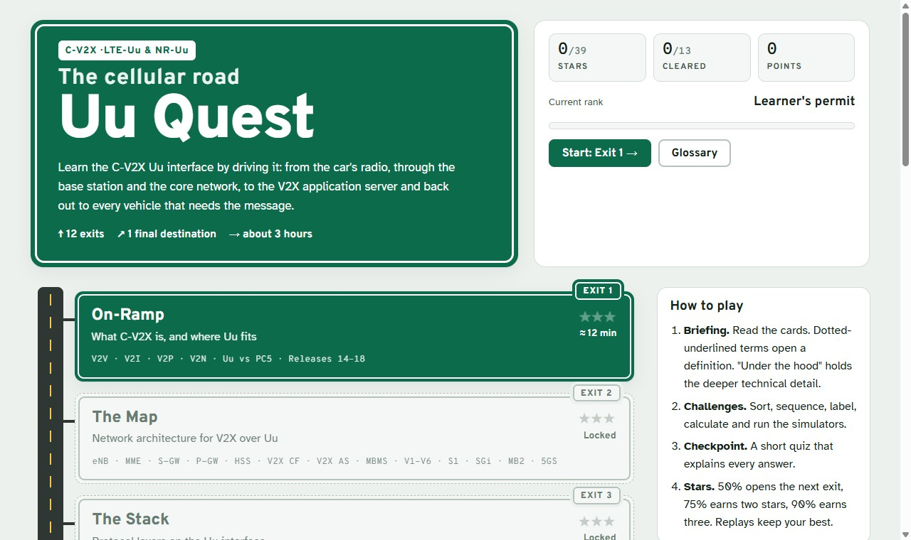

# C-V2X Uu Quest

**A free browser game that teaches the C-V2X Uu interface, from the car's radio to the cloud and back.**

**Play:** <https://s-dasgupta.github.io/cv2x-uu-quest/> · no install, no account, works on a phone



Cellular V2X gives a vehicle two radio interfaces: **PC5**, the direct sidelink between cars, and **Uu**, the
cellular link through the base station and the operator's network. Uu Quest teaches the Uu side completely:
the theory, the architecture and the technical detail, through short briefings, hands-on challenges and
simulators. A companion game, **PC5 Quest**, will cover the sidelink.

## The route

The course is a highway. Each lesson is an exit; clear one (50% or better) to open the next.

| Exit | Title | What you learn | Hands-on |
|---|---|---|---|
| 1 | On-Ramp | V2V/V2I/V2P/V2N, Uu vs PC5, Releases 14–18 | Route ten messages to Uu or PC5 |
| 2 | The Map | eNB, MME, S-GW, P-GW, HSS, PCRF, V2X Control Function, V2X AS, MBMS; reference points; the 5G core | Label 16 reference points on the architecture |
| 3 | The Stack | PDCP, RLC (TM/UM/AM), MAC, PHY, RRC, NAS | Build the stack; follow a 300-byte message down to the antenna |
| 4 | The Grid | OFDM, frames and slots, resource blocks, PDCCH/PSS/SSS/PBCH/CRS, CQI and MCS | Find each channel in a real LTE subframe |
| 5 | Join the Network | Cell search, random access, attach and AKA, V2X provisioning over V3 | Order the procedures as message sequence charts |
| 6 | Pipes & Channels | Logical/transport/physical channels, DCI formats, EPS bearers, QCI 3/75/79, 5QI 82–86 | Channel mapping and a QoS desk |
| 7 | Beat the Clock | SR → grant → PUSCH, HARQ, SPS and the Rel-14 enhancements, end-to-end latency | **Latency lab**: hit 100, 50 and 20 ms budgets |
| 8 | Broadcast the Hazard | Uu-based V2X message flow, unicast vs MBSFN vs SC-PTM, TMGI/SAI/USD | **Broadcast commander**: warn the right cells at the lowest cost |
| 9 | Keep Moving | RRC states, RSRP/RSRQ, A3, hysteresis and time-to-trigger, X2 handover, Doppler | **Handover highway**: tune for 60, 120 and 250 km/h |
| 10 | Lock It Down | AKA, the key hierarchy, GUTI/SUCI, IEEE 1609.2 message signatures | Key ladder and threat-vs-defence |
| 11 | The Conductor | How Uu schedules the sidelink: SIB21, SL BSR, DCI 5A, sidelink SPS, NR DCI 3_0/3_1 | Run a Mode 3 grant |
| 12 | 5G NR Uu | Numerology, SSB and bandwidth parts, configured grants, SDAP and QoS flows, V2X slicing | Numerology drills; LTE → NR mapping |
| — | Destination | One black-ice warning followed end to end | 14-step final exam and certificate |

Every briefing card has a plain-language explanation, a diagram, a "Remember" summary, an optional
"Under the hood" section with the technical detail, and the 3GPP specifications it draws on. Every
acronym opens a glossary definition (about 160 terms). Every quiz answer is explained.

## Run it locally

Open `index.html` in a browser. That is all: the game is one self-contained file with no dependencies
(fonts load from Google Fonts when online and fall back to system fonts offline). Progress is kept in the
browser's local storage only.

## Develop

The page is built from the parts in `src/`:

| File | Contents |
|---|---|
| `src/00-head.html` | Title, fonts, all CSS (light and dark themes) |
| `src/10-body.html` | Page skeleton |
| `src/20-core.js` | Engine: route map, exit player, progress, glossary, generic challenge types, diagram helpers |
| `src/30-sims.js` | Interactive figures and simulators (resource grid, latency lab, broadcast commander, handover highway, numerology) |
| `src/40-glossary.js` | Glossary |
| `src/50-…52-exits-*.js` | The content of the 12 exits and the final exam |
| `src/90-boot.js` | Start-up |

```sh
node tools/build.mjs   # writes index.html (and dist/artifact.html)
node tools/check.mjs   # index.html up to date, script compiles, glossary complete, no unexpected hosts
```

Node 18 or newer, no packages. The `check` workflow runs `tools/check.mjs` on every push.

## Accuracy

Facts follow 3GPP Releases 14–18, mainly TS 22.185/22.186 (requirements), TS 23.285/23.287 (V2X
architecture), TS 23.401, 23.203, 23.246, 23.501, TS 36.211/213/300/321/331, TS 38.211/300 and
TS 33.401/33.185. The latency lab, broadcast cost model and handover simulator are deliberately simplified
teaching models; the game says so where they appear. If you find an error, please open an issue with the
exit, the card and the spec clause.

## Licences and copyright

- **Code** (HTML, CSS, JavaScript in `src/` and `tools/`): [MIT](LICENSE).
- **Teaching text** (briefings, quiz questions, explanations, glossary): [CC BY 4.0](LICENSE-CONTENT.txt).
  Reuse it in your own courses with attribution: "C-V2X Uu Quest, github.com/s-dasgupta/cv2x-uu-quest".
- No text from 3GPP, ETSI, IEEE or SAE documents is reproduced. See [NOTICE.md](NOTICE.md) for the
  standards, trademark and font notices and how this was checked.

Not affiliated with or endorsed by 3GPP, ETSI, IEEE or SAE International.
